# **Evaluación de rutas y operación de entregas de Logística del Valle**

## **1. Introducción**

Logística del Valle necesita evaluar si sus rutas actuales y sus ocho vehículos permiten responder a la demanda y entregar los pedidos dentro del límite de 75 minutos. Para estudiar este problema, se construyó un grafo utilizando la matriz de tiempos proporcionada.

Se compararon Dijkstra, A* y Hill Climbing, y se simuló la operación con las rutas actuales y las obtenidas mediante Dijkstra. Asimismo, se evaluaron flotas de ocho, diez y doce vehículos en época normal, Semana Santa y Navidad. Los resultados se presentan mediante una aplicación interactiva y permiten analizar cómo cambian la espera, el tiempo de entrega y la puntualidad al modificar las rutas, la demanda y la cantidad de vehículos.

## **2. Objetivos**

### **Objetivo general**

Aplicar un algoritmo de búsqueda de rutas al grafo de la empresa para medir su efecto en el tiempo de entrega y en la puntualidad de los pedidos.

### **Objetivos específicos**

1. Comparar tres algoritmos de búsqueda de rutas para justificar la selección del más adecuado para la red de la empresa.
2. Calcular los tiempos de ida y regreso de la ruta actual y de al menos dos alternativas válidas para cada destino.
3. Medir mediante simulación cómo cambian los tiempos de espera y entrega y la puntualidad de los pedidos al variar rutas, demanda y cantidad de vehículos.

## **3. Formulación del modelo**

### **Datos proporcionados**

#### **Red de distribución**

La empresa Logística del Valle distribuye productos de farmacia desde la bodega N01 hacia cuatro destinos: N08, N19, N34 y N40. La red cuenta con 40 ubicaciones y sus conexiones se proporcionan mediante una matriz de adyacencia, es decir, una tabla donde cada fila representa un origen y cada columna un destino. Los valores indican los minutos de viaje entre dos ubicaciones, el cero identifica el mismo punto y la ausencia de un valor en el archivo CSV indica que no existe una conexión directa.

Cabe mencionar que las conexiones pueden cambiar según el sentido de circulación, ya que algunas calles son de un solo sentido. Por ello, poder viajar directamente de un punto a otro no garantiza que se pueda regresar por ese mismo tramo ni que el tiempo sea igual en ambos sentidos. No se proporciona un mapa, por lo que la representación de la red debe construirse a partir de la matriz.

Las hojas de despacho proporcionan los siguientes recorridos actuales de ida y señalan que el vehículo debe regresar por el mismo camino en sentido inverso:

| Destino | Recorrido actual de ida |
|---|---|
| N08 | N01 -> N02 -> N03 -> N04 -> N05 -> N06 -> N07 -> N08 |
| N19 | N01 -> N02 -> N03 -> N11 -> N19 |
| N34 | N01 -> N09 -> N17 -> N25 -> N33 -> N34 |
| N40 | N01 -> N02 -> N03 -> N04 -> N05 -> N06 -> N07 -> N08 -> N16 -> N24 -> N32 -> N40 |

#### **Operación de entregas**

La empresa dispone inicialmente de ocho vehículos y cada uno transporta un solo pedido por viaje. Después de realizar la entrega, debe regresar a la bodega antes de atender otro pedido. Cuando todos los vehículos están ocupados, los pedidos esperan y se atienden en el orden en que fueron recibidos.

Una entrega se considera puntual cuando se completa en 75 minutos o menos desde que se recibe la solicitud, incluyendo el tiempo de espera y el traslado hasta el destino. La recepción de pedidos dura ocho horas; sin embargo, si al terminar ese período todavía hay pedidos por completar, la simulación debe continuar hasta finalizar los recibidos durante la jornada.

#### **Demanda de pedidos**

El promedio de pedidos por hora cambia acorde a la época del año:

| Escenario | Promedio de pedidos por hora |
|---|---:|
| Normal | 4 |
| Semana Santa | 6 |
| Navidad | 10 |

Estos valores representan promedios y las solicitudes llegan de manera variable durante la jornada, por lo que no establecen intervalos fijos entre pedidos. Asimismo, cada uno de los cuatro destinos recibe aproximadamente la misma proporción de solicitudes.

### **Decisiones que se evaluarán**

Se evaluará el efecto de utilizar las rutas actuales o sustituirlas por las obtenidas mediante el algoritmo de búsqueda seleccionado. Los recorridos alternativos se determinarán a partir de las conexiones y los tiempos de la red, para poder comparar cómo cambia el servicio con cada opción.

Asimismo, se comenzará con los ocho vehículos actuales y se realizarán pruebas con diez y doce vehículos. Se compararán los tiempos de espera y entrega y la puntualidad de los pedidos, para poder determinar cuánto aporta aumentar la cantidad de vehículos ante las distintas demandas de la actividad.

### **Supuestos**

1. Se supone que la entrega del pedido es inmediata una vez que el vehículo llega al destino, ya que en la actividad no se especifica un tiempo determinado en el que se tenga que quedar el camión haciendo la entrega del pedido.
2. Se supone que al iniciar la jornada todos los vehículos se encuentran disponibles en la bodega.
3. Se supone que los pedidos llegan de forma aleatoria durante la jornada, con un promedio esperado constante y acorde a cada época. Esto permite que se presenten períodos con una mayor concentración de pedidos y otros con menos llegadas, sin establecer horarios específicos de alta demanda.

## **4. Construcción del grafo**

### **Representación de los datos**

El grafo es una representación de la red donde cada ubicación corresponde a un nodo y cada conexión indica un desplazamiento directo entre dos ubicaciones. Se representa como un grafo dirigido y ponderado, es decir, cada conexión tiene un sentido de circulación y un valor que corresponde al tiempo de viaje en minutos.

Para organizar esta información se utilizan dos clases de datos, **Node** y **Connection**, que permiten agrupar las propiedades de cada nodo y de sus conexiones:

| Clase | Propiedad | Descripción |
|---|---|---|
| **Node** | **identifier** | Identificador de la ubicación, como N01 o N08. |
| **Node** | **achievableDestinations** | Lista de objetos **Connection** que representan las conexiones directas de salida. |
| **Connection** | **destinationId** | Identificador de la ubicación a la que lleva la conexión. |
| **Connection** | **travelTimeMinutes** | Tiempo necesario para recorrer la conexión, expresado en minutos. |

Esta organización se conoce como lista de adyacencia, ya que cada nodo conserva una lista de sus conexiones directas. El origen de una conexión queda determinado por el nodo al que pertenece la lista, por lo que no es necesario repetirlo dentro de **Connection**. Asimismo, registrar una conexión de A hacia B no implica agregar otra de B hacia A, porque cada sentido debe respetar los datos de la matriz.

Se conserva el destino junto con el tiempo dentro de cada conexión para poder leer ambos datos en un mismo objeto. La lista incluye únicamente conexiones directas, mientras que los recorridos que pasan por varias ubicaciones se obtendrán mediante el algoritmo de búsqueda.

### **Lectura de la matriz**

La lectura del archivo se concentra en **csv_reader.py**, dentro de **src/graph**, y se realiza mediante la función **read_graph**. Primero, se toman los identificadores de la cabecera para crear los nodos. Luego, se recorre cada fila y se agrega una conexión por cada tiempo positivo que corresponda a otra ubicación, usando la columna para identificar el destino. Las celdas vacías no generan conexiones y los ceros de la diagonal se omiten, ya que representan el mismo punto.

El lector devuelve una lista de objetos **Node** con sus conexiones de salida. Adicional, comprueba que los identificadores no se repitan, que las filas tengan la cantidad de campos esperada y que los tiempos de viaje sean válidos, para poder detectar errores antes de utilizar la red en la búsqueda de rutas. La carga de la matriz proporcionada produce 40 nodos y 144 conexiones dirigidas, sin añadir conexiones inversas que no estén registradas en los datos.

### **Grafo generado**

La figura 1 muestra la red de 40 ubicaciones y 144 conexiones dirigidas dentro de la aplicación. Las flechas representan el sentido de circulación; la disposición de los nodos es un esquema de conexiones, no un mapa geográfico. Las figuras 1a y 1b amplían dos sectores con solapamiento, para poder leer los identificadores de todos los nodos sin cambiar la red.

**Figura 1. Red de distribución generada a partir de la matriz original.**

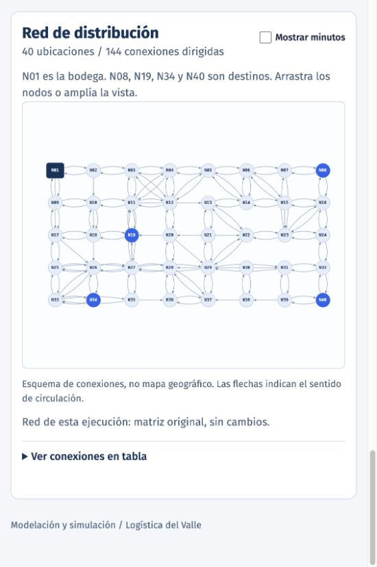

**Figura 1a. Detalle ampliado del sector izquierdo de la red.**

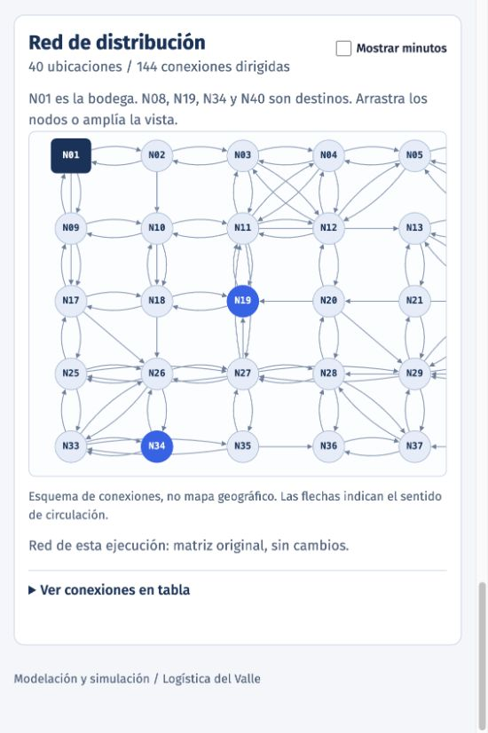

**Figura 1b. Detalle ampliado del sector derecho de la red.**

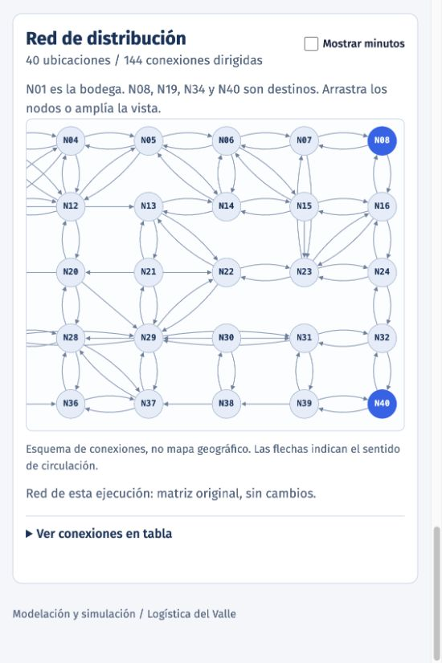

## **5. Comparación y selección de algoritmos**

### **Algoritmos implementados**

Se implementaron **Dijkstra**, **A*** y **Hill Climbing** dentro de **src/algorithms**, usando los objetos del grafo para consultar las conexiones disponibles. Cada algoritmo recibe la red, el origen y el destino, y devuelve el recorrido encontrado, su tiempo total, los nodos visitados durante la búsqueda y un estado que indica el resultado. La ida y el regreso se consultan por separado, ya que sus conexiones y tiempos pueden ser distintos.

| Algoritmo | Ventajas para esta red | Limitaciones para esta red |
|---|---|---|
| **Dijkstra** | Encuentra recorridos de tiempo mínimo con los tiempos positivos de esta red, sin necesitar una heurística. | Examinó más nodos que A* en las ocho consultas, 227 frente a 147, aunque esto no implicó un mayor tiempo completo de cálculo. |
| **A*** | Conserva los recorridos de tiempo mínimo con la heurística definida y examinó menos nodos durante la búsqueda que Dijkstra. | Requiere preparar la heurística en cada consulta. Al incluir esa preparación, su tiempo completo promedio fue de 0.345 ms, frente a los 0.214 ms de Dijkstra. |
| **Hill Climbing** | Con la heurística utilizada, la estimación restante disminuye en cada paso y se obtienen recorridos válidos para los destinos evaluados. | No garantiza el menor tiempo total, porque elige una salida sin volver a explorar las opciones descartadas. Por ejemplo, la ida a N08 tardó 57 minutos, frente a los 51 de Dijkstra y A*. |

Para describir los algoritmos se toman como referencia los artículos de GeeksforGeeks. Dijkstra selecciona el nodo con el menor costo acumulado y actualiza los costos de sus vecinos (GeeksforGeeks, 2026a). A* combina ese costo con una estimación restante, cuya definición influye en la búsqueda y en la posibilidad de obtener un camino mínimo (GeeksforGeeks, 2026c). Hill Climbing avanza hacia un vecino que mejora su evaluación, pero puede detenerse sin alcanzar la mejor solución global (GeeksforGeeks, 2026b). Los tres algoritmos se programaron directamente en Python.

### **Estimación utilizada en la búsqueda**

Una heurística es una estimación que orienta la búsqueda hacia el destino. Como la actividad no proporciona coordenadas, para A* y Hill Climbing se utiliza el mínimo de conexiones necesarias para llegar al destino, multiplicado por el menor tiempo de una conexión de la red. Por ejemplo, si hacen falta al menos tres conexiones y el menor tiempo es de cuatro minutos, la estimación es de doce minutos. El número mínimo de conexiones se obtiene recorriendo la red por niveles desde el destino sobre las conexiones invertidas; esa operación permite identificar qué nodos pueden llegar a él, sin calcular sus tiempos óptimos.

Esta estimación no supera el tiempo real mínimo, ya que cualquier recorrido necesita al menos esa cantidad de conexiones y cada una tarda como mínimo el menor tiempo registrado. Además, para una conexión de A hacia B, la estimación desde A no supera el tiempo de ese tramo más la estimación desde B; esta propiedad permite mantener coherente la búsqueda de A*. La estimación se recalcula en cada consulta, para poder considerar cambios de tiempos y cierres.

En Hill Climbing se minimiza la estimación restante y, si hay empate, se elige el tramo de menor tiempo y luego el identificador del destino. Con esta heurística concreta, un nodo que puede alcanzar la meta tiene una salida con una estimación menor, por lo que se evita el estancamiento en esos recorridos. Sin embargo, reducir el número de conexiones restantes no garantiza reducir el tiempo total. No se sustituye su resultado por el de otro algoritmo.

Cabe mencionar que calcular esta estimación requiere recorrer los nodos y las conexiones de la red antes de la búsqueda. Ese trabajo debe incluirse si posteriormente se comparan tiempos de ejecución; los nodos registrados como visitados en el resultado corresponden a la búsqueda del algoritmo y no a ese preprocesamiento.

### **Justificación del algoritmo seleccionado**

Primero, se compararon los tres algoritmos con demanda normal, de Semana Santa y de Navidad, utilizando ocho, diez y doce vehículos. Cada una de estas nueve configuraciones se ejecutó con cinco repeticiones, usando las semillas del 42 al 46 y los mismos pedidos para cada algoritmo. Dijkstra y A* obtuvieron los mismos resultados de puntualidad, espera, tiempo hasta la entrega, utilización de vehículos y tiempo adicional al cierre, por lo que estas métricas representan un empate entre ambos.

Hill Climbing presentó resultados menos favorables en varias de las métricas observadas. Por ejemplo, con demanda normal y ocho vehículos, Dijkstra y A* obtuvieron un 98.84% de entregas puntuales, frente al 98.27% de Hill Climbing. El tiempo promedio desde la solicitud hasta la entrega fue de 37.24 minutos frente a 39.17, y el máximo fue de 79.50 frente a 85.50 minutos. Sin embargo, la mediana de entrega fue de 47 minutos en los tres algoritmos y la mediana y el mínimo de espera fueron cero, por lo que no todas las medidas permiten distinguirlos.

Para poder desempatar entre Dijkstra y A*, se midió el tiempo completo de calcular las ocho rutas, correspondientes a la ida y el regreso de los cuatro destinos. Se realizaron 5,000 mediciones por algoritmo en cinco rondas de 1,000, después de 200 ejecuciones iniciales por algoritmo que no se incluyeron en los resultados. Se alternó el orden de ejecución de forma aleatoria y equilibrada, utilizando la misma red cargada en memoria. La medición incluyó la validación del grafo y la preparación de la heurística de A* en cada consulta, sin reutilizarla entre búsquedas; no incluyó la lectura del CSV, la simulación de pedidos ni la interfaz. Las pruebas se realizaron con Python 3.14.7 en macOS 15.1 sobre arquitectura ARM64.

| Tiempo de cálculo de las ocho rutas | Dijkstra | A* |
|---|---:|---:|
| Promedio (ms) | 0.214 | 0.345 |
| Mediana (ms) | 0.211 | 0.340 |
| Mínimo (ms) | 0.185 | 0.300 |
| Máximo (ms) | 2.402 | 1.909 |

Considero que Dijkstra es la opción a seleccionar para esta implementación, ya que conservó los mismos resultados de entrega que A* y obtuvo un tiempo de cálculo promedio aproximadamente 38% menor, con un promedio y una mediana inferiores en las cinco rondas. A* examinó 147 nodos durante las ocho búsquedas frente a los 227 de Dijkstra; sin embargo, ese conteo no incluye la preparación de su heurística y la reducción de nodos examinados no se tradujo en un menor tiempo completo de ejecución.

Cabe mencionar que el máximo observado de Dijkstra fue mayor, por lo que no se afirma que ganó en todas las métricas. Asimismo, la diferencia promedio fue de aproximadamente 0.131 milisegundos y se utiliza únicamente como criterio de desempate técnico, no como una mejora adicional en la puntualidad. Esta selección corresponde a la red, la implementación y el equipo evaluados, y no demuestra que Dijkstra sea más rápido para cualquier problema.

## **6. Validación de rutas alternativas**

### **Criterio de comparación**

Primero, se comprobó que cada par consecutivo de ubicaciones estuviera conectado en el sentido utilizado, y se sumaron sus tiempos para obtener la duración del recorrido. La misma comprobación se realizó para el regreso, ya que no se puede asumir que invertir la ida produce un camino válido. Las cuatro rutas actuales y sus recorridos inversos son válidos en la matriz proporcionada.

Luego, se comparó cada ruta actual con dos alternativas cuya ida es distinta de la actual y distinta entre sí, manteniendo las conexiones originales. Para esta comparación se utiliza Dijkstra como primera alternativa, y para N08 se toma la ida de Hill Climbing como segunda opción. Para los otros destinos se busca otro camino válido mediante desvíos, reutilizando Dijkstra para completar cada recorrido candidato. Esta búsqueda adicional no representa un cierre vial: las restricciones de búsqueda se aplican sobre copias de la red y los recorridos se comprueban con la misma matriz original.

El regreso de ambas alternativas puede coincidir, ya que los caminos de ida permiten distinguirlas. Asimismo, una ruta distinta puede tener el mismo tiempo que otra, como ocurre en N34. La segunda alternativa no se presenta necesariamente como la segunda más rápida de la red, porque en N08 se utiliza el recorrido obtenido por Hill Climbing.

### **Tiempos de las rutas**

| Destino | Opción | Ida (min) | Regreso (min) | Total (min) |
|---|---|---:|---:|---:|
| N08 | Actual | 59 | 59 | 118 |
| N08 | Alternativa 1, Dijkstra | 51 | 59 | 110 |
| N08 | Alternativa 2, Hill Climbing | 57 | 59 | 116 |
| N19 | Actual | 33 | 33 | 66 |
| N19 | Alternativa 1, Dijkstra | 18 | 24 | 42 |
| N19 | Alternativa 2 | 20 | 24 | 44 |
| N34 | Actual | 42 | 42 | 84 |
| N34 | Alternativa 1, Dijkstra | 24 | 34 | 58 |
| N34 | Alternativa 2 | 24 | 34 | 58 |
| N40 | Actual | 93 | 93 | 186 |
| N40 | Alternativa 1, Dijkstra | 47 | 61 | 108 |
| N40 | Alternativa 2 | 51 | 61 | 112 |

### **Recorridos de las alternativas**

#### **Destino N08**

- **Alternativa 1:** N01 -> N09 -> N10 -> N11 -> N13 -> N22 -> N23 -> N07 -> N08.
- **Alternativa 2:** N01 -> N02 -> N03 -> N12 -> N05 -> N06 -> N07 -> N08.
- **Regreso de ambas:** N08 -> N07 -> N06 -> N05 -> N04 -> N03 -> N02 -> N01.

#### **Destino N19**

- **Alternativa 1:** N01 -> N02 -> N18 -> N19.
- **Alternativa 2:** N01 -> N17 -> N18 -> N19.
- **Regreso de ambas:** N19 -> N18 -> N10 -> N09 -> N01.

#### **Destino N34**

- **Alternativa 1:** N01 -> N17 -> N26 -> N34.
- **Alternativa 2:** N01 -> N02 -> N18 -> N26 -> N34.
- **Regreso de ambas:** N34 -> N26 -> N25 -> N17 -> N09 -> N01.

#### **Destino N40**

- **Alternativa 1:** N01 -> N17 -> N25 -> N27 -> N29 -> N31 -> N32 -> N40.
- **Alternativa 2:** N01 -> N17 -> N25 -> N27 -> N29 -> N31 -> N39 -> N40.
- **Regreso de ambas:** N40 -> N32 -> N31 -> N29 -> N27 -> N11 -> N10 -> N09 -> N01.

### **Conveniencia de las rutas actuales**

Las rutas actuales permiten completar los viajes, pero no son las de menor tiempo entre las opciones comparadas. Con la primera alternativa, el recorrido completo disminuye 8 minutos para N08, 24 para N19, 26 para N34 y 78 para N40. Por ejemplo, la segunda ida de N40 suma 9 + 8 + 5 + 6 + 7 + 9 + 7 = 51 minutos, y junto con los 61 minutos del regreso produce un total de 112, frente a los 186 de la ruta actual.

Cabe mencionar que la ida actual de N40 tarda 93 minutos, por lo que no permite cumplir el límite de 75 minutos ni siquiera cuando el pedido sale de inmediato. Las alternativas comparadas reducen ese tiempo de viaje; sin embargo, esto no garantiza una entrega puntual, porque todavía debe considerarse la espera por un camión. Por ello, la comparación de rutas complementa la simulación y no sustituye sus resultados.

## **7. Descripción de la simulación**

### **Generación de pedidos**

Primero, se generan los pedidos durante el horario de recepción. Los tiempos entre llegadas se obtienen mediante una distribución exponencial, que permite intervalos variables manteniendo el promedio esperado de cada época. Con cuatro, seis y diez pedidos por hora, el intervalo esperado es de quince, diez y seis minutos, respectivamente. Esta distribución se utiliza como supuesto del modelo, no como un dato proporcionado por la actividad.

Cada pedido recibe aleatoriamente uno de los cuatro destinos, con una probabilidad de 25% para cada uno. No se obliga a recibir una cantidad fija de pedidos ni a distribuirlos exactamente por partes iguales.

### **Atención de pedidos y disponibilidad de vehículos**

Al iniciar, todos los vehículos están disponibles en N01 y no hay pedidos pendientes. Los pedidos se atienden en orden de llegada y se asignan al primer vehículo que quede disponible. Cada camión transporta un pedido, realiza la entrega inmediata al llegar y regresa a la bodega antes de recibir otro.

Para cada pedido se registran los instantes de llegada, salida, entrega y regreso. La puntualidad se calcula desde la solicitud hasta la entrega, incluyendo la espera, pero sin incluir el regreso.

### **Comparación de políticas y finalización**

En cada repetición se genera una lista de pedidos y se reutiliza sin cambios para comparar las rutas actuales contra las recomendadas por el algoritmo. Así, ambas políticas reciben los mismos destinos e instantes de llegada.

Al terminar el horario de recepción no se aceptan nuevos pedidos, pero se continúa hasta entregar todos los recibidos y completar los regresos. El tiempo adicional corresponde al período entre el cierre de recepción y el último regreso, cuando este ocurre después del cierre.

### **Utilización de vehículos**

La utilización se calcula dividiendo los minutos ocupados de los camiones dentro del horario de recepción entre los minutos disponibles de toda la flota durante ese horario. Incluye los viajes de ida y regreso, pero no la espera de los pedidos.

### **Indicadores de tiempo**

Para los tiempos de espera por un camión y los tiempos desde la solicitud hasta la entrega, se calculan el promedio, la mediana, el mínimo y el máximo. La mediana es el valor central al ordenar los tiempos y, cuando hay dos valores centrales, se obtiene el promedio de ambos. Por otro lado, el mínimo y el máximo permiten identificar los extremos observados, para poder distinguir un tiempo habitual de los casos que tuvieron una espera o entrega más prolongada.

Estos valores se calculan para cada jornada y cada política de rutas. En el resumen de las repeticiones se agrupan los tiempos individuales de todos los pedidos, sin promediar las medianas ni los extremos de cada jornada, ya que eso puede producir valores distintos a los del conjunto completo. Asimismo, se conserva el porcentaje de entregas realizadas en 75 minutos o menos, porque las medidas de tiempo no sustituyen la evaluación de puntualidad. Cabe mencionar que el máximo representa el mayor tiempo observado en las ejecuciones, no un límite garantizado para jornadas futuras.

## **8. Aplicación configurable**

### **Tecnologías seleccionadas**

Se utiliza **Dash** para construir la aplicación web desde Python, ya que permite conectar los controles de la interfaz con las funciones que procesan la red y ejecutan el modelo. Para representar el grafo se utiliza **Dash Cytoscape**, que permite explorar los nodos y sus conexiones, modificar su presentación y responder a la selección de elementos. Asimismo, se utiliza **Plotly** para las gráficas de resultados de los escenarios.

La representación del grafo forma parte de la aplicación interactiva y las imágenes del informe se obtuvieron mediante capturas de esa misma vista. De esta forma, la información presentada en el informe corresponde a la red y a los resultados mostrados por la aplicación.

### **Organización de la aplicación**

La vista principal incluye un desplegable para seleccionar entre **Dijkstra**, **A*** y **Hill Climbing**, otro para elegir entre **8, 10 y 12 camiones** y uno para seleccionar la época. El botón **Simular** ejecuta el cálculo de rutas y cinco repeticiones de la simulación completa, comparando las rutas actuales con las del algoritmo seleccionado. Debajo se muestran los indicadores, las gráficas y el grafo, para poder revisar el escenario desde una misma vista.

Los parámetros de demanda, duración de recepción y semilla aleatoria se agrupan en un panel plegable de configuración, junto con la modificación de tiempo o el cierre de una conexión. La semilla permite repetir la misma secuencia de pedidos, de tal forma que se pueda revisar una ejecución bajo las mismas condiciones. Los cálculos y la representación visual utilizan la misma red de datos, sin modificar la matriz original.

### **Actualización de rutas ante cambios de red**

Al presionar **Simular**, se carga la matriz original y se aplica el cambio configurado sobre una copia del grafo. Modificar el tiempo de una conexión o cerrarla afecta únicamente el sentido seleccionado, sin cambiar automáticamente el recorrido inverso ni el archivo CSV. El cambio se mantiene durante toda la ejecución.

Con la red resultante se comprueban las rutas actuales y se recalculan la ida y el regreso del algoritmo seleccionado, junto con las alternativas adicionales. La aplicación actualiza el grafo, la tabla de conexiones y los resultados de la simulación. Si un cierre invalida una ruta actual o impide completar la ida y el regreso del algoritmo, se muestra el motivo y no se ejecuta la comparación. No se sustituye la ruta actual por otra, ya que eso cambiaría la política evaluada. Los experimentos del apartado 9 utilizaron la matriz original sin modificaciones.

### **Criterio de color**

Se utilizan distintas tonalidades de azul para organizar los elementos de la interfaz y destacar las selecciones. El rojo se reserva para señalar errores y se acompaña de un mensaje que explica qué ocurrió, de tal forma que el significado no depende únicamente del color.

### **Tipografía**

Se utiliza **Fira Sans** para los títulos, botones y textos de la interfaz, con un tamaño de 16 píxeles para el texto principal. Para los identificadores y las cifras de las tablas se utiliza **Fira Code**, cuyos caracteres tienen un ancho uniforme, para poder mantener la alineación de los datos. Los títulos tienen tamaños moderados y los tiempos se acompañan de su unidad en minutos.

## **9. Experimentos y resultados**

### **Condiciones de las pruebas**

Se evaluaron nueve configuraciones, combinando las épocas normal, Semana Santa y Navidad con flotas de ocho, diez y doce camiones. Se utilizaron tasas de cuatro, seis y diez pedidos por hora, respectivamente, con ocho horas de recepción y la matriz original, sin modificar conexiones.

Cada configuración se ejecutó con cinco repeticiones y semillas del 42 al 46. En cada repetición se compararon las rutas actuales y las de Dijkstra, reutilizando los mismos pedidos, destinos e instantes de llegada. También se conservaron los mismos pedidos al cambiar la flota dentro de cada época. En total se realizaron 45 parejas de ejecuciones, equivalentes a 90 simulaciones.

### **Puntualidad y operación**

En las cinco repeticiones de cada configuración se recibieron 173 pedidos en época normal, 265 en Semana Santa y 436 en Navidad. Las cantidades de pedidos y entregas puntuales de la tabla corresponden al total de las cinco repeticiones. El porcentaje de puntualidad se calculó sobre ese total, mientras que la utilización y el tiempo adicional de operación se promediaron por jornada.

| Época | Camiones | Rutas | Puntuales / pedidos | Puntualidad (%) | Utilización (%) | Tiempo adicional (min) |
|---|---:|---|---:|---:|---:|---:|
| Normal | 8 | Actuales | 92 / 173 | 53.18 | 85.40 | 143.65 |
| Normal | 8 | Dijkstra | 171 / 173 | 98.84 | 64.90 | 80.15 |
| Semana Santa | 8 | Actuales | 36 / 265 | 13.58 | 93.34 | 377.13 |
| Semana Santa | 8 | Dijkstra | 196 / 265 | 73.96 | 88.90 | 136.70 |
| Navidad | 8 | Actuales | 32 / 436 | 7.34 | 96.01 | 864.51 |
| Navidad | 8 | Dijkstra | 60 / 436 | 13.76 | 96.01 | 451.29 |
| Normal | 10 | Actuales | 128 / 173 | 73.99 | 70.45 | 122.59 |
| Normal | 10 | Dijkstra | 173 / 173 | 100.00 | 51.98 | 80.15 |
| Semana Santa | 10 | Actuales | 97 / 265 | 36.60 | 91.24 | 248.33 |
| Semana Santa | 10 | Dijkstra | 258 / 265 | 97.36 | 75.93 | 106.23 |
| Navidad | 10 | Actuales | 42 / 436 | 9.63 | 95.25 | 618.82 |
| Navidad | 10 | Dijkstra | 120 / 436 | 27.52 | 95.15 | 290.12 |
| Normal | 12 | Actuales | 133 / 173 | 76.88 | 59.09 | 116.86 |
| Normal | 12 | Dijkstra | 173 / 173 | 100.00 | 43.32 | 80.15 |
| Semana Santa | 12 | Actuales | 163 / 265 | 61.51 | 82.84 | 193.04 |
| Semana Santa | 12 | Dijkstra | 265 / 265 | 100.00 | 64.93 | 87.30 |
| Navidad | 12 | Actuales | 57 / 436 | 13.07 | 94.30 | 468.70 |
| Navidad | 12 | Dijkstra | 253 / 436 | 58.03 | 93.14 | 188.96 |

### **Tiempos de espera por un camión**

Se agruparon los tiempos de espera individuales de las cinco repeticiones para calcular el promedio, la mediana, el mínimo y el máximo. Los valores se presentan en minutos y se redondean a dos decimales.

| Época | Camiones | Rutas | Promedio (min) | Mediana (min) | Mínimo (min) | Máximo (min) |
|---|---:|---|---:|---:|---:|---:|
| Normal | 8 | Actuales | 17.57 | 4.81 | 0.00 | 80.75 |
| Normal | 8 | Dijkstra | 2.24 | 0.00 | 0.00 | 32.39 |
| Semana Santa | 8 | Actuales | 106.11 | 102.58 | 0.00 | 296.78 |
| Semana Santa | 8 | Dijkstra | 25.64 | 17.78 | 0.00 | 110.11 |
| Navidad | 8 | Actuales | 341.02 | 312.59 | 0.00 | 884.55 |
| Navidad | 8 | Dijkstra | 176.12 | 162.68 | 0.00 | 486.64 |
| Normal | 10 | Actuales | 2.75 | 0.00 | 0.00 | 38.21 |
| Normal | 10 | Dijkstra | 0.16 | 0.00 | 0.00 | 10.45 |
| Semana Santa | 10 | Actuales | 40.76 | 30.55 | 0.00 | 154.85 |
| Semana Santa | 10 | Dijkstra | 5.99 | 0.00 | 0.00 | 48.80 |
| Navidad | 10 | Actuales | 220.66 | 200.57 | 0.00 | 626.43 |
| Navidad | 10 | Dijkstra | 93.21 | 76.95 | 0.00 | 309.80 |
| Normal | 12 | Actuales | 0.24 | 0.00 | 0.00 | 15.93 |
| Normal | 12 | Dijkstra | 0.00 | 0.00 | 0.00 | 0.00 |
| Semana Santa | 12 | Actuales | 13.43 | 0.00 | 0.00 | 97.90 |
| Semana Santa | 12 | Dijkstra | 0.91 | 0.00 | 0.00 | 20.05 |
| Navidad | 12 | Actuales | 142.51 | 123.69 | 0.00 | 440.96 |
| Navidad | 12 | Dijkstra | 43.63 | 29.06 | 0.00 | 197.67 |

### **Tiempos desde la solicitud hasta la entrega**

Se calcularon las mismas medidas sobre los tiempos individuales desde la solicitud hasta la entrega, incluyendo la espera y el viaje de ida.

| Época | Camiones | Rutas | Promedio (min) | Mediana (min) | Mínimo (min) | Máximo (min) |
|---|---:|---|---:|---:|---:|---:|
| Normal | 8 | Actuales | 73.64 | 72.34 | 33.00 | 171.27 |
| Normal | 8 | Dijkstra | 37.24 | 47.00 | 18.00 | 79.50 |
| Semana Santa | 8 | Actuales | 162.32 | 153.44 | 33.00 | 377.24 |
| Semana Santa | 8 | Dijkstra | 60.46 | 55.57 | 18.00 | 157.11 |
| Navidad | 8 | Actuales | 397.62 | 372.39 | 33.00 | 975.64 |
| Navidad | 8 | Dijkstra | 210.97 | 189.60 | 18.00 | 533.64 |
| Normal | 10 | Actuales | 58.83 | 59.00 | 33.00 | 129.45 |
| Normal | 10 | Dijkstra | 35.16 | 31.28 | 18.00 | 57.45 |
| Semana Santa | 10 | Actuales | 96.97 | 93.00 | 33.00 | 247.85 |
| Semana Santa | 10 | Dijkstra | 40.82 | 47.00 | 18.00 | 99.80 |
| Navidad | 10 | Actuales | 277.25 | 254.62 | 33.00 | 694.55 |
| Navidad | 10 | Dijkstra | 128.06 | 111.55 | 18.00 | 352.22 |
| Normal | 12 | Actuales | 56.31 | 57.93 | 33.00 | 93.00 |
| Normal | 12 | Dijkstra | 35.01 | 24.00 | 18.00 | 51.00 |
| Semana Santa | 12 | Actuales | 69.64 | 59.00 | 33.00 | 190.72 |
| Semana Santa | 12 | Dijkstra | 35.73 | 35.81 | 18.00 | 66.19 |
| Navidad | 12 | Actuales | 199.10 | 180.55 | 33.00 | 533.96 |
| Navidad | 12 | Dijkstra | 78.48 | 67.93 | 18.00 | 244.67 |

Los resultados por repetición y los valores sin redondear se conservaron en **docs/resultados_experimentos.json**.

### **Capturas de los escenarios simulados**

Las figuras 2 a 10 se obtuvieron directamente de la aplicación, utilizando Dijkstra, ocho horas de recepción, cinco repeticiones y semillas del 42 al 46, sin cambios en la matriz. En cada captura, la barra de rutas actuales se compara con la del algoritmo seleccionado, que corresponde a Dijkstra. Se muestran el tiempo promedio desde la solicitud hasta la entrega y el porcentaje de entregas puntuales. La aplicación presenta estos valores con un decimal, mientras que las tablas anteriores utilizan dos.

#### **Ocho camiones**

**Figura 2. Época normal con ocho camiones.**

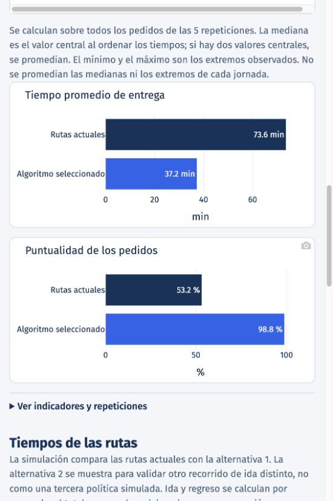

**Figura 3. Semana Santa con ocho camiones.**

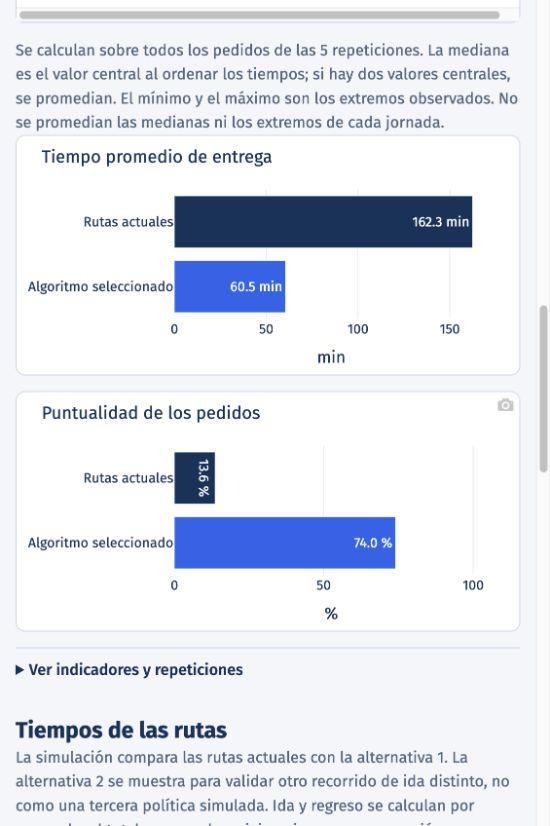

**Figura 4. Navidad con ocho camiones.**

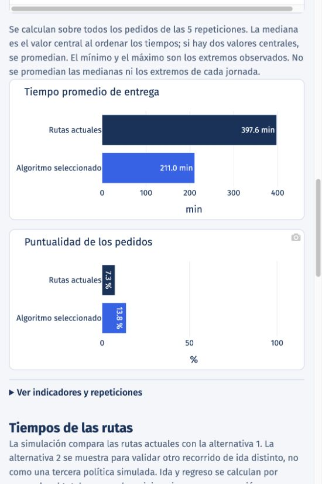

#### **Diez camiones**

**Figura 5. Época normal con diez camiones.**

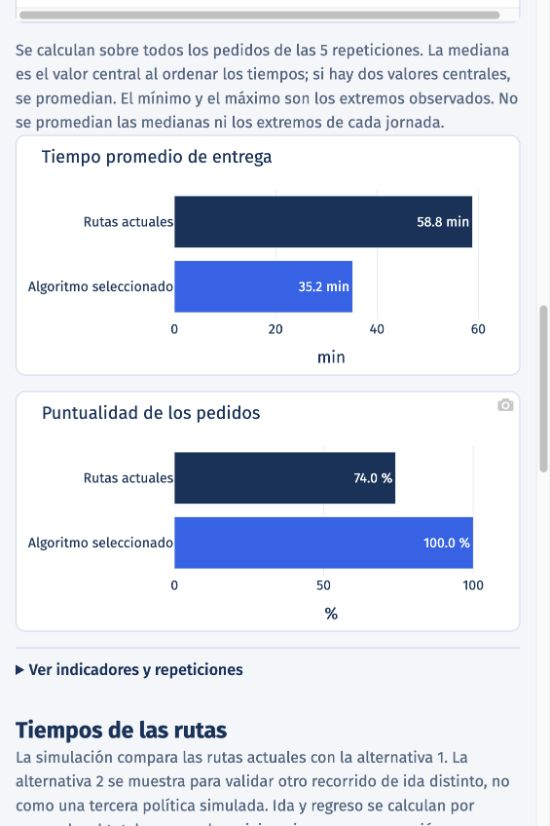

**Figura 6. Semana Santa con diez camiones.**

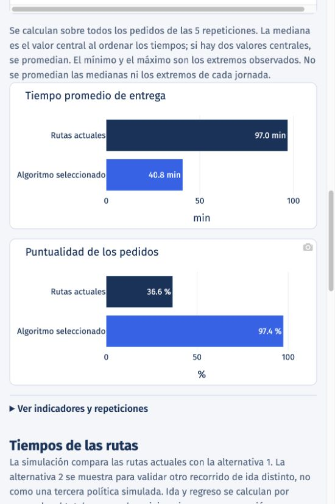

**Figura 7. Navidad con diez camiones.**

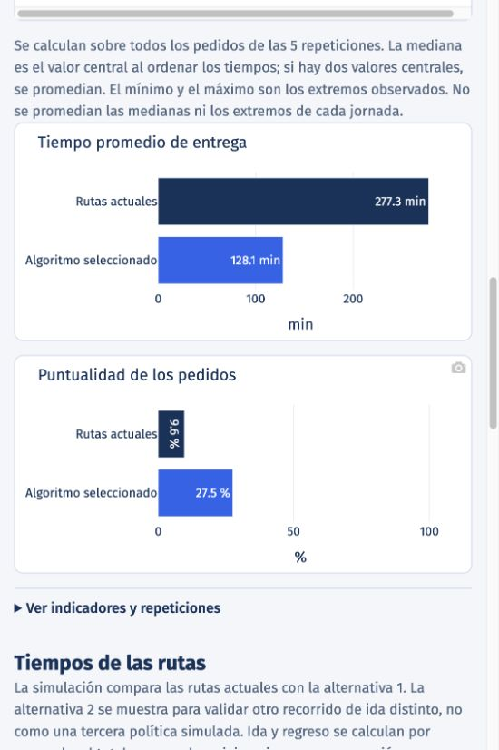

#### **Doce camiones**

**Figura 8. Época normal con doce camiones.**

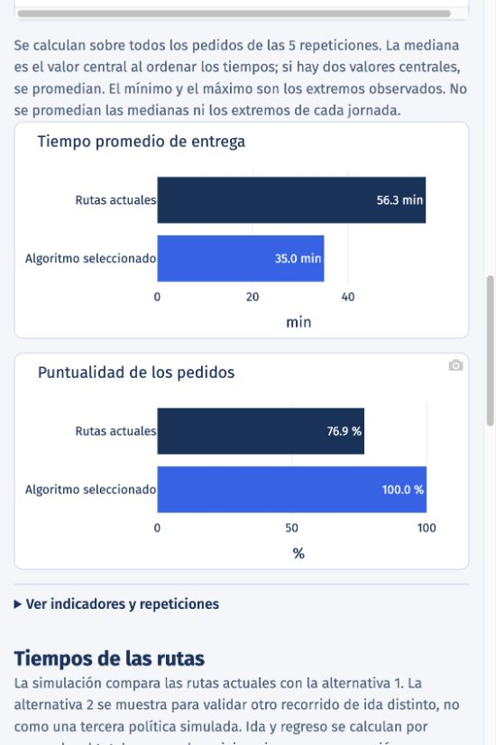

**Figura 9. Semana Santa con doce camiones.**

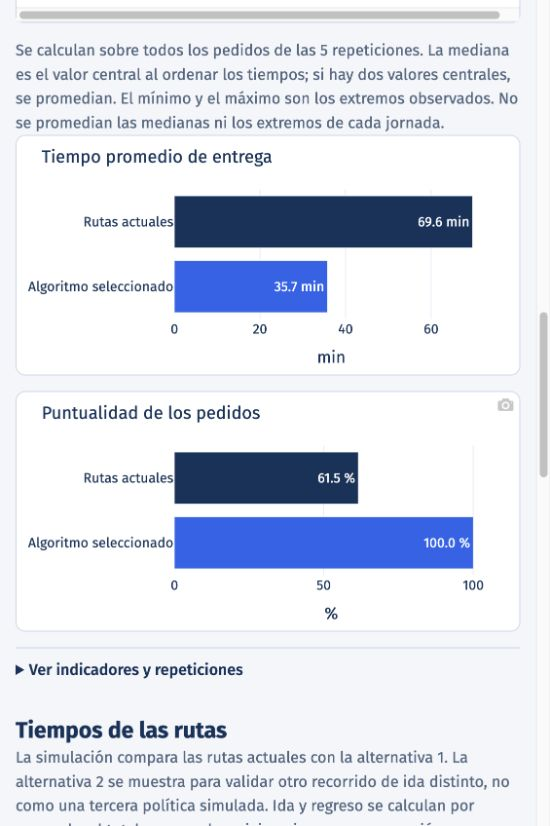

**Figura 10. Navidad con doce camiones.**

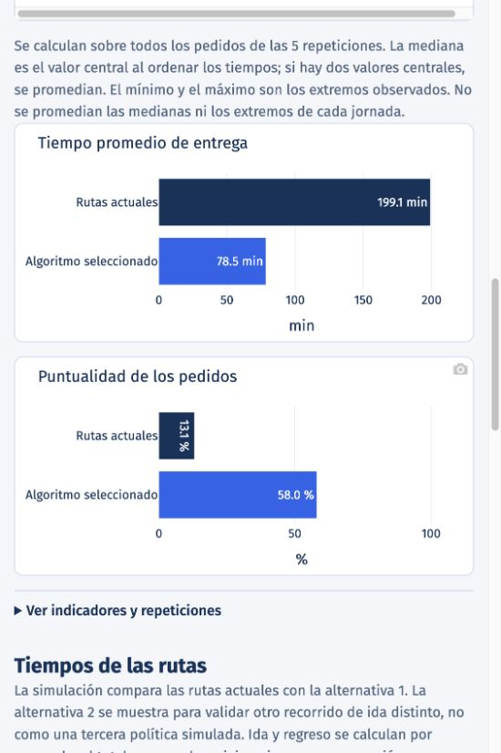

## **10. Discusión**

### **Operación en época normal**

Considero que mantener ocho camiones es una alternativa base razonable para la época normal al utilizar las rutas de Dijkstra, ya que se completaron puntualmente 171 de los 173 pedidos de las cinco repeticiones, equivalentes al 98.84%. Sin embargo, no se cumple el límite en todos los casos: el tiempo máximo hasta la entrega fue de 79.50 minutos, aunque el promedio fue de 37.24 y la mediana de 47 minutos. Por ello, un promedio favorable no sustituye la revisión de las entregas que superaron los 75 minutos.

Si se dispone de diez camiones, los resultados respaldan preferir esa opción para mejorar el servicio, porque los 173 pedidos llegaron puntualmente en las pruebas. La espera promedio disminuyó de 2.24 a 0.16 minutos y la máxima pasó de 32.39 a 10.45 minutos. Asimismo, el tiempo promedio hasta la entrega disminuyó a 35.16 minutos, la mediana a 31.28 y el máximo a 57.45. Con doce camiones se eliminó la espera en estas ejecuciones, pero no se añadió puntualidad frente a diez: el promedio hasta la entrega fue de 35.01 minutos, la mediana de 24 y el máximo de 51 minutos. La mediana y el mínimo de espera fueron cero en las tres flotas, y el mínimo hasta la entrega fue de 18 minutos, por lo que esas medidas no permiten diferenciarlas.

La utilización promedio durante la recepción fue de 64.90%, 51.98% y 43.32% para ocho, diez y doce camiones, respectivamente. Esta disminución no representa una reducción de los pedidos atendidos, ya que se conservó la misma carga de trabajo y se distribuyó entre más vehículos. Por otro lado, la operación adicional promedio fue de 80.15 minutos en las tres flotas. Se comprobó que los viajes que determinaron el último regreso salieron sin esperar en cada configuración, por lo que aumentar los vehículos no adelantó esos regresos.

Cabe mencionar que, en una operación real, incorporar nuevos camiones podría representar un incremento considerable en los costos, tanto por los pagos de adquisición o financiamiento de los vehículos como por los gastos asociados a su operación, entre ellos la gasolina. El gasto de combustible también depende del uso, los kilómetros recorridos y el consumo de cada vehículo, por lo que no se puede asumir un aumento proporcional a la cantidad de camiones. Como estos costos no se proporcionan ni se incluyen en la simulación, no se puede afirmar cuál flota resulta más económica. Bajo esta idea, se mantiene ocho como alternativa base y se prefiere diez si hay disponibilidad, sin plantear doce como necesarios para esta época ni interpretar el 100% observado como una garantía para jornadas futuras.

### **Operación en Semana Santa**

En Semana Santa, los resultados muestran una mayor limitación de la flota de ocho camiones, incluso utilizando Dijkstra. De los 265 pedidos recibidos en las cinco repeticiones, 196 llegaron puntualmente, equivalentes al 73.96%, y 69 superaron los 75 minutos. Aunque el promedio hasta la entrega fue de 60.46 minutos y la mediana de 55.57, el máximo alcanzó 157.11 minutos. Asimismo, la espera promedio fue de 25.64 minutos, la mediana de 17.78 y la máxima de 110.11. Por ello, el promedio de entrega por debajo del límite no permite afirmar que la flota respondió puntualmente a toda la demanda.

Con diez camiones se completaron puntualmente 258 pedidos, equivalentes al 97.36%, por lo que todavía hubo siete entregas tardías. La espera promedio disminuyó a 5.99 minutos, la mediana a cero y la máxima a 48.80. El tiempo promedio hasta la entrega fue de 40.82 minutos, la mediana de 47 y el máximo de 99.80. Con doce camiones, los 265 pedidos llegaron puntualmente en las pruebas, la espera promedio fue de 0.91 minutos y la máxima de 20.05, manteniendo una mediana de espera de cero. El promedio hasta la entrega disminuyó a 35.73 minutos, la mediana a 35.81 y el máximo a 66.19. En las tres flotas, el mínimo de espera fue cero y el mínimo hasta la entrega fue de 18 minutos.

La utilización promedio durante la recepción disminuyó de 88.90% con ocho camiones a 75.93% con diez y 64.93% con doce, mientras que la operación adicional promedio pasó de 136.70 a 106.23 y 87.30 minutos, respectivamente. Considero que doce es la opción preferente entre las evaluadas si se busca priorizar la puntualidad en Semana Santa, ya que, a diferencia de época normal, aumentar de diez a doce mejoró tanto la puntualidad como las esperas, los tiempos de entrega y la operación después del cierre. Diez se conserva como una alternativa con mejoras importantes, pero sin omitir las siete entregas tardías observadas. Al tratarse de una demanda estacional, convendría evaluar un refuerzo temporal antes de asumir una adquisición permanente; sin datos de costos, no se puede establecer su conveniencia económica ni interpretar el 100% observado como una garantía futura.

### **Operación en Navidad**

Navidad representa el escenario de mayor demanda de la actividad, con diez pedidos por hora frente a los cuatro de época normal, es decir, una tasa 2.5 veces mayor. Como contexto estacional, la celebración y la compra de regalos pueden incrementar la presión sobre los servicios de entrega en general. Sin embargo, la empresa del caso distribuye productos de farmacia y la actividad no proporciona los motivos de compra, por lo que no se atribuye directamente ese aumento a los regalos. En la simulación, la mayor demanda se representa mediante la tasa indicada para Navidad, sin añadir aumentos por hora ni causas que no se hayan medido.

Al comparar las tres flotas con Dijkstra, ocho camiones completaron puntualmente 60 de los 436 pedidos de las cinco repeticiones, diez completaron 120 y doce completaron 253, equivalentes al 13.76%, 27.52% y 58.03%, respectivamente. La espera promedio disminuyó de 176.12 a 93.21 y 43.63 minutos, mientras que la mediana pasó de 162.68 a 76.95 y 29.06, y la máxima de 486.64 a 309.80 y 197.67 minutos. Aunque incorporar vehículos redujo la acumulación de pedidos, incluso con doce hubo esperas prolongadas. El mínimo de espera fue cero en las tres flotas, pero ese valor no representa el comportamiento del conjunto.

El tiempo promedio desde la solicitud hasta la entrega fue de 210.97, 128.06 y 78.48 minutos para ocho, diez y doce camiones, respectivamente. Las medianas fueron de 189.60, 111.55 y 67.93 minutos, y los máximos de 533.64, 352.22 y 244.67. El mínimo hasta la entrega fue de 18 minutos en los tres casos. Cabe mencionar que, con doce camiones, la mediana ya está por debajo de los 75 minutos; sin embargo, todavía se registraron 183 entregas tardías, por lo que ese resultado no permite afirmar que la demanda navideña quedó resuelta.

La utilización promedio durante la recepción permaneció elevada, con 96.01%, 95.15% y 93.14% para ocho, diez y doce camiones. Asimismo, la operación adicional promedio disminuyó de 451.29 a 290.12 y 188.96 minutos, pero incluso la mayor flota evaluada necesitó alrededor de tres horas adicionales para finalizar, incluyendo los regresos. Considero que doce camiones ofrecen el mejor desempeño entre las opciones probadas, pero no representan una solución completa para esta época. Para poder determinar un refuerzo suficiente sería necesario definir una meta de puntualidad, realizar nuevas pruebas y evaluar los costos asociados, sin asumir que conviene adquirir permanentemente más vehículos para responder a una demanda estacional.

### **Alcance del modelo**

No se incorporaron factores adicionales, como variaciones del tráfico, ya que la actividad no proporciona datos para representarlos. Incluirlos requeriría asignar valores sin respaldo en la información disponible e introducir condiciones adicionales al problema planteado. Por ello, los resultados se interpretan a partir de los datos de la actividad y los supuestos declarados.

## **11. Conclusiones**

Aplicar Dijkstra mejoró el tiempo de entrega y la puntualidad frente a las rutas actuales. En época normal con ocho camiones, el tiempo promedio hasta entregar disminuyó de 73.64 a 37.24 minutos y la puntualidad aumentó de 53.18% a 98.84% en las pruebas realizadas.

Dijkstra y A* obtuvieron los mismos resultados operativos, mientras que Hill Climbing presentó resultados menos favorables en varias métricas. Se seleccionó Dijkstra porque su tiempo completo de cálculo promedio fue aproximadamente 38% menor que el de A*, con una mediana también inferior, en la implementación evaluada.

Se validaron la ruta actual y dos alternativas para cada destino, calculando la ida y el regreso por separado. Frente a las rutas actuales, los recorridos completos de Dijkstra redujeron 8 minutos para N08, 24 para N19, 26 para N34 y 78 para N40.

El efecto de aumentar la flota dependió de la demanda: con Dijkstra, diez camiones alcanzaron 100% de puntualidad en época normal y doce en Semana Santa. En Navidad, pasar de ocho a doce redujo la mediana de espera de 162.68 a 29.06 minutos y el máximo hasta entregar de 533.64 a 244.67 minutos, pero la puntualidad solo alcanzó 58.03%.

## **12. Reflexión final**

Considero que este trabajo muestra que aumentar los recursos no siempre debe ser la primera respuesta a un problema, ya que también es necesario revisar cómo se están utilizando. Por ejemplo, en época normal, mantener ocho camiones y cambiar las rutas mediante Dijkstra elevó la puntualidad de 53.18% a 98.84%, mientras que aumentar a doce camiones conservando las rutas actuales solo alcanzó 76.88%. En ese escenario, mejorar la estrategia de recorridos aportó más que incorporar vehículos.

Dijkstra y A* obtuvieron los mismos resultados de entrega, lo que permite destacar el beneficio de utilizar algoritmos para planificar las rutas. Esta idea también puede trasladarse a otros problemas de computación: antes de aumentar la capacidad del equipo, conviene revisar si un cambio de algoritmo o de enfoque permite aprovechar mejor los recursos disponibles. Para la empresa, esto podría evitar inversiones innecesarias, aunque en este trabajo no se calcularon ahorros económicos.

Sin embargo, mejorar la estrategia no elimina cualquier limitación de capacidad. En Navidad, incluso doce camiones con Dijkstra alcanzaron únicamente 58.03% de puntualidad. Por ello, considero que la decisión debe combinar una mejor planificación con los recursos que requiera cada demanda, tomando los resultados como apoyo bajo los datos y supuestos del modelo, no como una garantía de la operación real.

Cabe mencionar que el modelo supone entregas inmediatas y llegadas aleatorias con un promedio esperado constante para cada época. En la operación real, descargar los pedidos podría mantener ocupados los camiones por más tiempo y las solicitudes podrían concentrarse en horarios específicos, por lo que las esperas y la puntualidad podrían diferir de los resultados obtenidos. Asimismo, los tiempos de viaje se mantuvieron según la matriz y no se incorporaron variaciones del tráfico, ya que la actividad no proporciona datos para representarlas e incluirlas implicaría inventar información adicional. Antes de aplicar estas recomendaciones, sería necesario contrastar los supuestos con registros reales de la empresa y repetir las pruebas, sin interpretar las cinco repeticiones como una garantía de jornadas futuras.

## **13. Referencias bibliográficas**

GeeksforGeeks. (2026a, 27 de julio). *Dijkstra's algorithm*. https://www.geeksforgeeks.org/dsa/dijkstras-shortest-path-algorithm-greedy-algo-7/

GeeksforGeeks. (2026b, 24 de agosto). *Hill climbing in artificial intelligence*. https://www.geeksforgeeks.org/artificial-intelligence/introduction-hill-climbing-artificial-intelligence/

GeeksforGeeks. (2026c, 25 de agosto). *A\* algorithm and its heuristic search strategy in AI*. https://www.geeksforgeeks.org/artificial-intelligence/a-algorithm-and-its-heuristic-search-strategy-in-artificial-intelligence/
